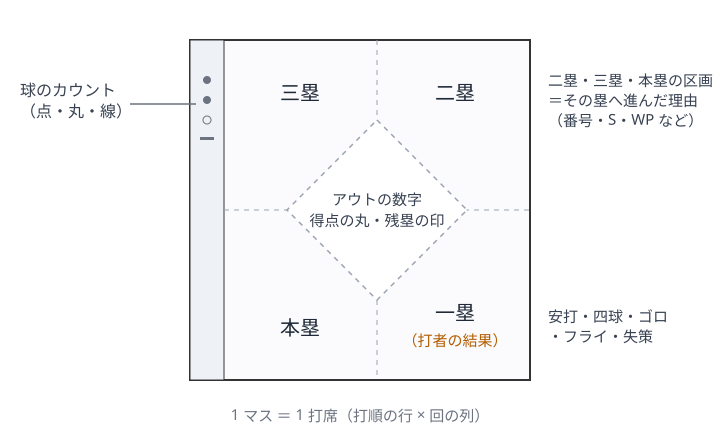

# 手書きのスコアブックの記号の読み方

ある草野球チームの手書きのスコアブック 33 枚を、全部のマスについて 1 つずつ書き起こしたときに分かった、記号の読み方の記録です。一般的なスコアの付け方に加えて、実物で出会った「記録者ごとの書き方の違い」を書いています。スコアブックを読む人・まとめる人・機械で読もうとする人の参考になればと思って公開しています。

> 範囲：1 種類の印刷の用紙で、1 チームの数人の記録者が書いたものです。ほかの用紙や地域では違う書き方もあります。選手名・チーム名・画像は載せていません。

## 1 マスの見方

打順の行と回の列が交わる 1 マスが、1 打席です。マスの真ん中に小さな菱形（ダイヤモンド）が印刷されています。マスを縦横の点線で 4 つに分けた区画が、それぞれの塁を表します。

| 場所 | 書くもの |
|---|---|
| 右下（一塁の区画） | 打者の結果（安打・四球・ゴロ・フライ・失策など） |
| 右上（二塁の区画） | 二塁へ進んだ理由 |
| 左上（三塁の区画） | 三塁へ進んだ理由 |
| 左下（本塁の区画） | 本塁へ還った理由 |
| 真ん中 | その回の何番目のアウトか（ローマ数字）、得点（小さな丸）、出塁して残塁（筆記体の ℓ のような印） |
| 左の細い帯 | 球のカウント（点・丸・線）。意味の付け方は記録者によって違う |

- アウトの数字は、基本は**アウトになった本人のマス**に書きます。打者でアウトになっても、出塁したあと走者でアウトになっても同じです。たとえば、四球で出て次の打者のゴロで二塁で封殺されたら、四球のマスにその回のアウトの番号（Ⅰ〜Ⅲ）を書きます。例外は下の「記録者による違い」にあります。
- 回の終わりには、最後の打者のマスの右下の角に二重の斜線（//）を引きます。

## 打者の結果（右下）

| 書き方 | 意味 |
|---|---|
| 斜線 ＋ 数字（例 `/8`） | その守備位置への安打（`/8`＝中堅への単打） |
| 斜線 ＋ 数字 2 つ（例 `/7-8`） | 2 人の間への安打（左中間） |
| 本塁から一塁・二塁へ線をなぞる ＋ 数字 | 二塁打（三塁打・本塁打は、なぞる塁が増える。本塁打は菱形を一周） |
| 数字-数字（例 `6-3`） | ゴロを遊撃手が捕って一塁へ送球し、アウト |
| 数字の上に弧（への字） | フライ（アウトならローマ数字と一緒） |
| `B` | 四球 |
| `DB`・`D.B`・`D-B` | 死球 |
| `K` | 三振（振り逃げで出塁したときは、出塁の位置に K） |
| 数字 ＋ `E`（例 `5E`） | その守備位置の失策で出塁 |
| `FC` | 野手選択 |

斜線 ＋ 数字でも、ローマ数字が一緒に書いてあればアウト（フライやライナー）、と書く記録者がいました。安打かアウトかは、ローマ数字があるか、出塁の印があるかで決めます。

## 走者の進み（右上・左上・左下）

| 書き方 | 意味 |
|---|---|
| `(5)` のように括弧つきの数字 | 5 番打者の打席のあいだに、その塁へ進んだ |
| 丸で囲んだ数字（本塁の区画） | その番号の打者の打席のあいだに得点した（括弧の代わりに、本塁だけ丸で囲む記録者がいる） |
| `S` | 盗塁（盗んだ塁の区画に書く） |
| `WP`・`PB` | 暴投・捕逸で進んだ（進んだ塁の区画に書く） |
| 数字 ＋ `E` | 失策で進んだ |
| 矢印だけ | 進んだが、どのプレーかは書いていない |

走者がアウトになったときは、その走者のマスにローマ数字と、アウトにした送球の順を書きます（例：`7-2`＝左翼手から捕手へ送球して本塁でアウト）。タッチアウトを `T.O`（タッチした塁の区画に）、本塁でのタッチアウトを `H.O` と書く記録者もいました。併殺は、アウトになった 2 人の行を中かっこ（{）でつないで書きます。

## 記録者による違い（実物で出会ったもの）

同じ用紙でも、記録者によって次のような違いがありました。読み手が知っていれば迷わずに済むものです。

- **アウトの数字の字形が崩れる**：3 つ目のアウトを Ⅳ や Ⅱ と書くことがある。飾り線つきの Ⅱ が Ⅲ に見えることもある。形ではなく「1 回のアウトは 3 つ」で決める。
- **3 つ目のアウトを書かずに回を終える**：走者のアウトで回が終わったときに書かない記録者がいた。
- **走者のアウトをどこに書くか**：アウトになった走者のマスに書く人と、封殺のアウトを原因になった打者のマスに書く人がいる。
- **進塁の番号の書き方**：全部に括弧つきの番号を書く人、本塁だけ丸で囲む人、番号を書かずに `WP`・`PB` など仕組みだけ書く人がいる。
- **安打だけ赤で書く人**がいる。
- **1 つの回が 2 列にまたがる**：打者が一巡して列が足りなくなると次の列へ続け、列の上に印刷された回の数字を手で振り直す人がいる。列 ＝ 回と決めつけず、アウトの数字と打順のつながりから回を決める。
- **タイブレーク**では、塁に置かれた走者を新しい列の自分の行に書く（打席ではない）。
- **時間切れ**では、最後の回が途中で止まる（アウトの数字も二重の斜線もない）。
- 集計の欄（右側の個人成績の欄、下の各回の安打・四球・失策の欄、投手の欄）は**空欄のことが多い**。集計は打席から数え直す。

## 読むときのコツ

1. 全体を見て、打順・名前・回ごとの得点の欄を読む。
2. 回の列を切り出して拡大し、1 打席ずつ「アウト・得点・残塁」のどれで終わったかを決める。
3. 迷ったら算術で決める。1 回のアウトは 3 つ（時間切れ・サヨナラの回を除く）。打席数 ＝ アウト ＋ 得点 ＋ 残塁（回ごとにも試合全体でも。タイブレークで置かれた走者は除く）。回ごとの得点の和 ＝ 試合の得点。

成績をまとめるところまでの流れと検算は [stats-from-scorebook.md](stats-from-scorebook.md) にあります。
