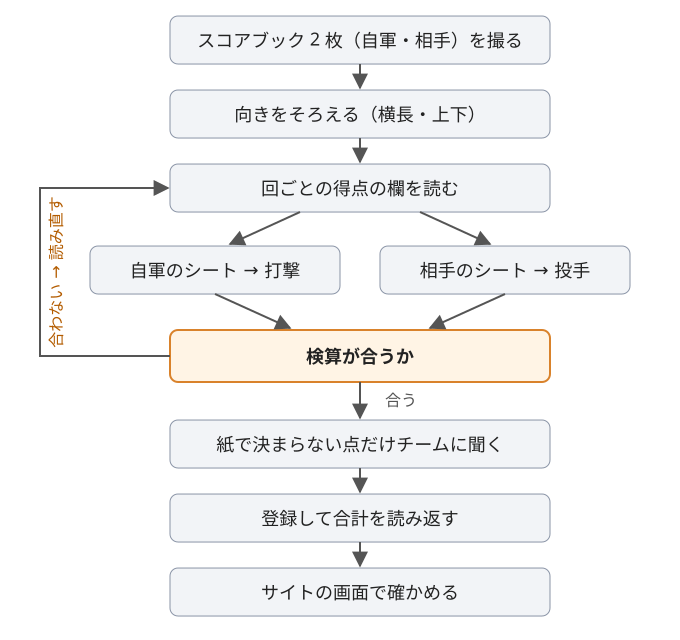

# 紙のスコアブックから個人成績をまとめる手順

草野球チーム「[横浜ファニーズ](https://yokohama-funnies.vercel.app/)」では、試合ごとに紙のスコアブック（自軍と相手の 2 枚）を写真に撮り、そこから試合結果・回ごとの得点・打撃成績・投手成績を起こして、チームのサイトに載せています。本来は人が目で読む作業で、いまは Claude Code（モデルは Claude Opus 5.5）がその役を担っています。写真を読み、成績を起こし、検算してデータベースに登録するところまでを Claude Code が行い、紙で決まらない点だけを担当者に確かめています。

ここでは、その流れと「数字が合っているか」を確かめるやり方をまとめます。スコアブックを付けている・まとめているチームの参考になればと思って公開しています。

> 選手名・実際の成績・スコアブックの画像・記録者ごとの書き癖の記録・登録に使うスクリプトは公開していません（非公開のリポジトリにあります）。

## 全体の流れ

**投手の成績は相手のシートから取ります。** 自軍の投手が打たれた安打・奪った三振・出した四死球は、相手チームの打撃として相手のシートに書かれているからです。

## 1. 写真の向きをそろえる

- スキャンアプリで撮った画像は縦長で、向きの情報（EXIF）も付いていないことが多いです。そのままでは横倒しのまま保存されます。
- そこで、まず横長に回します。次に上下を、**上半分と下半分のインクの量の比**で決めます（回ごとの得点の欄や見出しのある側が濃くなります）。
- 比が 1 に近くて決められないときや、紙の外側の黒い縁が写り込んだときは、自動で決めずに止めて、目で見て決めます。
- 原本の画像は保存しておき、後から見直せるようにしています（チームの会員だけが見られる場所）。

## 2. 読む順番

1. **回ごとの得点の欄**（スコアボードと同じ形の表。このチームの用紙では左上）。各回の得点の和が合計と一致するまで読み直します。1 点ずれるときは、たいてい数字の読み落としです。
2. **打順と交代**。1 つの打順の欄に 2 人の名前があれば、上が先発です。交代した回は、欄に名前や波線で書いてあることが多いです。
3. **打席ごとの結果**。回の列を上から順に、1 打席ずつ「アウト・出塁して残塁・得点」のどれで終わったかを決めます。
4. **拡大して読む**。全体 → 回の列 → 1 マスの順に拡大します。小さく書かれた記号や、重なった記号は全体図では読めません。

記録者によって書き方の癖があります。**記号の形で迷ったら「1 回のアウトは 3 つ」という算術で決めます。**

## 3. 検算（いちばん大事）

読み終えたら、次の式がすべて合うかを確かめます。合わなければ、どこかの読みが違っています。

| 確かめること | 式 |
|---|---|
| 得点 | 回ごとの得点の和 ＝ 試合の得点 |
| 打席の行き先 | 打席数 ＝ アウト数 ＋ 得点 ＋ 残塁（回ごとにも、試合全体でも） |
| 打数 | 打数 ＝ 打席数 − 四死球 − 犠打・犠飛 − 打撃妨害での出塁 |
| 交代した枠 | 先発と途中出場の打席数の和 ＝ その打順の枠の打席数 |
| 投手の失点 | 投手の失点の合計 ＝ 相手の得点 |
| 投手の対戦打者 | 投手ごとの対戦打者の和 ＝ 相手シートの打席数 |

- 盗塁死・けん制死・走塁死も「アウト」に数えます。打席の行き先の式は、打者が塁に出たあとアウトになった場合も含めて合います。
- 走者が 3 つ目のアウトになって回が終わったとき、打席に立っていた打者の打席は数えません（次の回の先頭でもう一度打席に立つため）。
- タイブレークで塁に置かれた走者は打席ではないので、その走者の得点・残塁は式から除きます。
- 時間切れで回の途中で終わった試合や、サヨナラで終わった試合、最終回の裏を行わなかった試合は、アウト数が「3 × 回数」になりません。実際に数えたアウトで合わせます。

実際の例（2026 年 11 月の 6 回・時間切れの試合）：

- 自軍の打席 28 ＝ アウト 18 ＋ 得点 5 ＋ 残塁 5
- 相手の打席 25 ＝ アウト 17（6 回裏は 2 死で終了）＋ 得点 1 ＋ 残塁 7

## 4. 紙だけでは決まらないことと、その決め方

紙で決まらない点だけを担当者に聞きます。相手・スコア・会場など、紙と予定表で分かることは聞きません。

| 紙だけでは決まらないこと | 決め方 |
|---|---|
| 同じ名字の選手が 2 人いる | 担当者に聞く |
| 投手を交代した回 | 担当者に聞く（守備位置の欄に投手が 2 人書いてあっても、交代の回は書いていないことが多い） |
| 打点 | 印が無いことが多い。走者の位置から推した値は「推定」としてメモに残す |
| 内野安打か野手選択か | 記号から決めた理由をメモに残す |
| 時間切れで途中で終わった回の投球回 | 担当者が決める（このチームでは、2/3 回で終わった回を 1 回と数えたことがある） |
| 勝ち投手 | このチームでは「最後に勝ち越した時点で投げていた投手」。公認野球規則の「先発は 5 回以上」は使わない |
| 負け投手 | 公認野球規則どおり。相手に最後の勝ち越し点を与えた走者を出した投手（その走者が交代後に還っても、出した投手の負け） |

決めたことと、その理由は、成績のメモ欄に残します。後で読み直したときに「なぜこの数字か」が分かるようにするためです。

## 5. データの形

チームのサイトでは、次の 3 つの表に分けて持っています（データベースは Supabase）。

| 表 | 1 行の単位 | 主な列 |
|---|---|---|
| 試合結果 | 1 試合 | 日付・相手・得点・失点・結果（○ ● △）・会場・回ごとの得点（自軍・相手・先攻か後攻か） |
| 打撃成績 | 1 試合 × 1 選手 | 打順の枠・同じ枠での出場順（先発 0）・打席・打数・安打（単打〜本塁打）・塁打・打点・四死球・犠打と犠飛・盗塁・三振 |
| 投手成績 | 1 試合 × 1 投手 | 登板順・投球回・失点・被安打・奪三振・与四死球・勝・敗・メモ |

- **打順の枠と出場順を持つ**と、試合ごとの成績を打順どおりに並べられ、代打・途中出場もどの枠の誰か分かります。
- 自責点を毎試合判定するのは難しいので、投手の率は失点を 7 回（このチームの試合の長さ）に換算した「失点 × 7 ÷ 投球回」で出しています。
- 試合ごとの投手成績の勝敗は、1 や 0 の数字でなく、勝ちは ○、負けは ●、どちらでもなければ空欄で表示しています。シーズンの勝敗数は数字のままです。

## 関連

- この手順の実物（選手名入りの記録・登録に使うスクリプトを含む）は非公開のリポジトリにあります 🔒
- スコアブックの写真を機械で読む研究開発の解説は、この repo の [README](README.md) にあります
